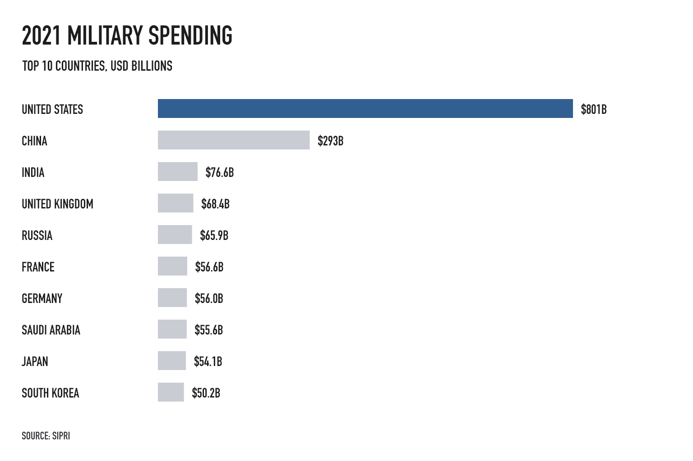

| [Home](https://yiranli-lyr.github.io/yiran-li-tswd-portfolio/) | [Data Visualization Examples](dataviz-examples) | [Critique by Design](critique-by-design) | [Final Project I](final-project-part-one) | [Final Project II](final-project-part-two) | [Final Project III](final-project-part-three) |

# Critique by Design: Global Military Spending

## Step one: Select the visualization

For this project, I selected Visual Capitalist's [*Ranked: The Top 10 Countries by Military Spending*](https://www.visualcapitalist.com/ranked-top-10-countries-by-military-spending/). The visualization uses data from the Stockholm International Peace Research Institute (SIPRI) to compare the ten countries with the largest military expenditures in 2021.

I chose this visualization because military spending is an important public-policy topic and the original graphic is immediately engaging. Its shell-like forms and national flags make the subject approachable and help the reader recognize the largest spenders quickly. At the same time, the unusual shapes make close comparisons difficult. This creates a useful redesign challenge: preserve the original's ability to attract attention while making the numerical relationships easier to judge.

## Step two: Critique the visualization

I evaluated the visualization using Stephen Few's Data Visualization Effectiveness Profile.

| Criterion | Score (1–10) | Rationale |
|---|---:|---|
| Usefulness | 7 | It communicates a relevant international comparison and makes the largest spenders easy to identify. |
| Completeness | 6 | It includes the major values and sources, but the relationship between total spending and spending as a share of GDP could be explained more clearly. |
| Perceptibility | 5 | The irregular shapes do not provide a common baseline, which makes accurate comparison difficult. Some smaller labeled percentages can appear visually larger than higher values. |
| Truthfulness | 7 | The labeled values and rankings communicate the underlying data, but the visual encoding can create a misleading impression of relative size. |
| Intuitiveness | 8 | The ranking, country flags, and labels make the general topic familiar and easy to recognize. |
| Aesthetics | 9 | The graphic is polished, distinctive, and visually memorable. |
| Engagement | 7 | The design attracts attention and may encourage readers to learn more, although the amount of information requires slow reading. |

### What works

The strongest feature is the visual concept. The shell-like forms are creative, and the flags let readers identify countries quickly. The hierarchy also makes the main finding clear: the United States and China spend substantially more than the other countries shown. The graphic is visually polished and makes a serious policy topic accessible to a broad audience.

### What could be improved

The main weakness is perceptual accuracy. Readers compare position and length more accurately than irregular areas, but the original design asks them to compare differently shaped objects. As a result, a value such as 2.7% can appear larger than 3.1%. The graphic also combines several labels, measures, annotations, colors, and shapes, which increases the effort required to find specific information.

The visualization is accurate enough for a quick overview, but it should distinguish more clearly between absolute military spending and military spending as a share of GDP. A large economy can rank highly in total dollars without devoting the largest share of its resources to the military. The chart also should not be interpreted as a direct measure of military strength, policy effectiveness, or geopolitical threat.

### Audience

The primary audience is likely general news readers and social-media users interested in global affairs, economics, or military policy. The informal, highly visual presentation is effective at gaining this audience's attention. It is less effective for readers who want to compare small differences or conduct detailed analysis because the decorative encoding competes with the data.

### Reflection on the critique method

Stephen Few's profile was useful because it separated effectiveness into specific criteria rather than treating the visualization as simply good or bad. It helped reveal that a chart can score highly in aesthetics and intuitiveness while scoring much lower in perceptibility. Compared with the *Good Charts* approach, Few's method is more diagnostic, while *Good Charts* places more emphasis on the balance among clarity, context, audience, and visual engagement. Together, the two methods suggest that an effective redesign should be both easy to compare and compelling enough to hold attention.

## Step three: Sketch a solution

My redesign will use a sorted horizontal bar chart. Every bar will begin at a common baseline, allowing readers to compare countries more accurately than they can with irregular areas. The chart will use one highlight color for the main finding and neutral colors for the remaining countries. Values will be labeled directly so that a separate legend is unnecessary.

The working title is:

> **The United States spent more on its military than any other country in 2021**

The subtitle will define the measure and unit:

> Military expenditure among the world's ten largest spenders, in billions of constant 2020 U.S. dollars.

The sketch will test three decisions:

1. Sort countries from highest to lowest.
2. Highlight the United States while keeping the other countries visually consistent.
3. Use the bar chart for total spending and reserve a separate aligned scale for spending as a share of GDP.

*Initial sketch: a horizontal bar chart comparing total military spending in 2021. The United States is highlighted in blue while the remaining countries are shown in gray.*

## Step four: Test the solution

I will show the sketch to at least two participants without first explaining how to read it. I will use the same questions in each session:

1. What do you think this visualization shows?
2. What is the main takeaway?
3. Is anything surprising or confusing?
4. Who do you think is the intended audience?
5. What would you change?

To protect privacy, participants will be described only in broad terms and no personally identifiable information will be recorded.

| Participant | Feedback | Planned design response |
|---|---|---|
| Participant 1: classmate | The typeface is too small and narrow, which makes the labels difficult to read. The limited color palette also makes the visualization feel monotonous. | Replace the condensed typeface with a larger, more readable sans-serif font. Use color purposefully to distinguish total spending from spending as a share of GDP. |

### Feedback synthesis

The feedback confirmed that the first sketch needs stronger readability and visual hierarchy. I will increase the label size, replace the condensed typeface, and introduce a second accent color rather than relying almost entirely on gray.

Reviewing the sketch also revealed a larger problem. The horizontal bars make the ranking easier to compare, but the redesign changed the original visualization into a general list of military budgets. By removing the percentage measures, I also removed an important contrast between absolute spending and the relative burden on each country's economy.

In the next iteration, I will retain the horizontal bars for total expenditure and add an aligned dot plot showing military spending as a share of GDP. Blue will represent total expenditure, while orange will represent GDP share. The title will state the main contrast: the United States spent the most in absolute terms, while Saudi Arabia devoted the largest share of its economy to the military among the ten countries shown.

## Step five: Build the solution

The final visualization will be produced after the user test so that the feedback can influence the design. It will retain the original topic and data while replacing the decorative shape comparison with a sorted horizontal bar chart. The final version will include direct labels, a clear unit, the data year, and a visible source note.

*[The final visualization and a short explanation of the changes will be added here.]*

## References

- Visual Capitalist. ["Ranked: The Top 10 Countries by Military Spending."](https://www.visualcapitalist.com/ranked-top-10-countries-by-military-spending/) August 25, 2022.
- Stockholm International Peace Research Institute. [SIPRI Military Expenditure Database](https://www.sipri.org/databases/milex).
- Makeover Monday. [Data archive](https://makeovermonday.co.uk/), 2022 Week 35.
- Kriebel, Andy. ["Makeover Monday 2022 Week 35 — The World's Biggest Military Spenders."](https://www.vizwiz.com/2022/08/mm2022-w35.html) August 29, 2022. Consulted after developing the initial critique and redesign direction.

## AI acknowledgements

I used an AI language assistant to help organize the assignment requirements and revise the clarity and structure of my written critique. I selected the visualization, assigned the evaluation scores, identified the perceptual issues, and will create and test the redesign.
