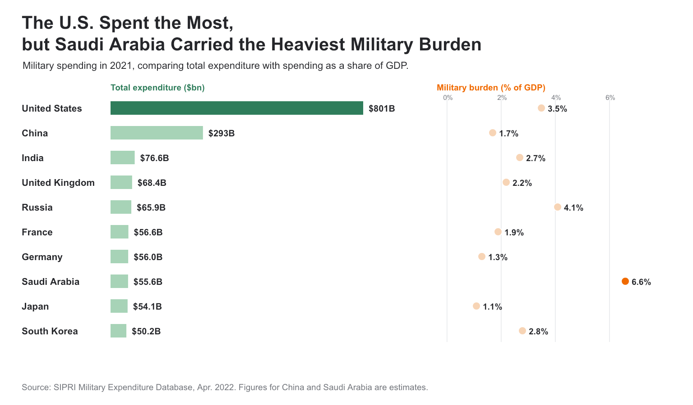

| [Home](https://yiranli-lyr.github.io/yiran-li-tswd-portfolio/) | [Data Visualization Examples](dataviz-examples) | [Critique by Design](critique-by-design) | [Final Project I](final-project-part-one) | [Final Project II](final-project-part-two) | [Final Project III](final-project-part-three) |

# Critique by Design: Global Military Spending

## Step one: Select the visualization

I selected Visual Capitalist's [*Ranked: The Top 10 Countries by Military Spending*](https://www.visualcapitalist.com/ranked-top-10-countries-by-military-spending/). The visualization uses data from the Stockholm International Peace Research Institute (SIPRI) to compare the ten countries with the largest military expenditures in 2021.

I chose it because the shell shaped forms and national flags make a public policy topic visually engaging. However, the irregular shapes make close comparisons difficult. The data also supports a useful contrast between total expenditure and military spending as a share of GDP.

## Step two: Critique the visualization

I evaluated the visualization using Stephen Few's Data Visualization Effectiveness Profile.

| Criterion | Score | Rationale |
|---|---:|---|
| Usefulness | 7 | It communicates a relevant international comparison and makes the largest spenders easy to identify. |
| Completeness | 6 | It includes the major values and sources, but does not clearly distinguish total expenditure from spending as a share of GDP. |
| Perceptibility | 5 | The shapes lack a common baseline, making accurate comparison difficult. Some lower percentages appear larger than higher percentages. |
| Truthfulness | 7 | The labels and ranking reflect the data, but the shapes can create a misleading impression of relative size. |
| Intuitiveness | 8 | The ranking, flags, and labels make the subject easy to recognize. |
| Aesthetics | 9 | The graphic is polished, distinctive, and memorable. |
| Engagement | 7 | The design attracts attention, but the number of visual elements slows interpretation. |

### What works

The flags identify countries quickly, and the visual hierarchy makes the two largest spenders easy to find. The polished design makes the topic accessible to a general audience.

### What could be improved

Readers compare position and length more accurately than irregular areas. In the original design, a value such as 2.7% can appear larger than 3.1%. Multiple labels, measures, colors, and shapes also compete for attention.

Total expenditure and share of GDP answer different questions. A large economy can spend more dollars without committing the largest share of its economy to the military. Neither measure directly represents military strength, policy effectiveness, or geopolitical threat.

### Audience

The primary audience is general news readers interested in global affairs, economics, or military policy. The design attracts this audience, but it is less effective for readers who want to compare small numerical differences.

### Reflection on the critique method

Stephen Few's profile separated effectiveness into specific criteria and showed that a visualization can be attractive and intuitive while remaining difficult to compare accurately. Compared with the *Good Charts* method, Few's approach is more diagnostic, while *Good Charts* gives greater attention to context, audience, clarity, and engagement.

## Step three: Sketch a solution

My initial sketch replaced the irregular shapes with a sorted horizontal bar chart. A common baseline made the ranking easier to compare, direct labels removed the need for a legend, and one highlight color directed attention to the United States.

*Initial sketch comparing total military spending in 2021.*

## Step four: Test the solution

During the class critique, I showed the sketch to a classmate without explaining it first. I asked what the chart showed, what its main takeaway was, what was confusing, who the intended audience might be, and what should change.

| Participant | Feedback | Design response |
|---|---|---|
| Participant 1: classmate | The typeface was too small and narrow. The limited color palette made the chart feel monotonous. | I replaced the condensed typeface with a larger sans serif font and used separate colors for total expenditure and GDP share. |

### Feedback synthesis

The feedback led me to increase the label size, replace the condensed typeface, and introduce a second color. I also found that the first sketch had reduced the original visualization to a general ranking. Removing the percentage measure eliminated the contrast between absolute expenditure and the relative burden on each country's economy. I retained the horizontal bars and added an aligned dot plot for military spending as a share of GDP.

## Step five: Build the solution

*Final redesign using the 2021 SIPRI data. China and Saudi Arabia are SIPRI estimates.*

The final visualization compares two measures for the ten largest military spenders in 2021. Horizontal bars show total expenditure in billions of U.S. dollars, while the aligned dot plot shows military spending as a share of GDP. The United States leads in total expenditure, while Saudi Arabia has the highest GDP share among the ten countries shown.

The redesign uses position and length for more accurate comparison. Direct labels show the values without a legend. Dark green highlights the United States in the expenditure chart, and orange highlights Saudi Arabia in the GDP chart. Lighter colors keep the remaining countries visible without competing with the main comparison. The title, larger type, and two measure layout reflect the critique and participant feedback.

## References

1. Visual Capitalist. ["Ranked: The Top 10 Countries by Military Spending."](https://www.visualcapitalist.com/ranked-top-10-countries-by-military-spending/) August 25, 2022.
2. Stockholm International Peace Research Institute. [SIPRI Military Expenditure Database](https://www.sipri.org/databases/milex).
3. Makeover Monday. [Data archive](https://makeovermonday.co.uk/), 2022 Week 35.
4. Kriebel, Andy. ["Makeover Monday 2022 Week 35: The World's Biggest Military Spenders."](https://www.vizwiz.com/2022/08/mm2022-w35.html) August 29, 2022. Consulted after I developed the initial critique and redesign direction.

## AI acknowledgements

I used an AI language assistant to organize the assignment requirements, revise the clarity of my writing, and consider design alternatives. I selected the visualization, assigned the evaluation scores, gathered participant feedback, and created the sketch and final visualization.
