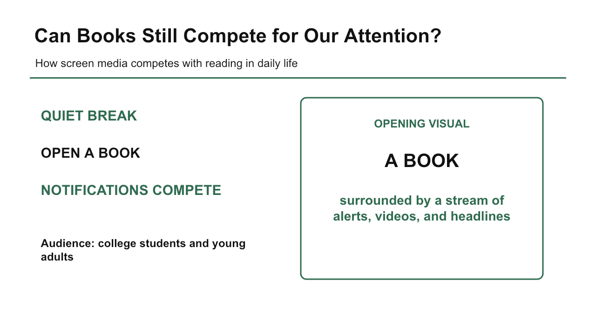
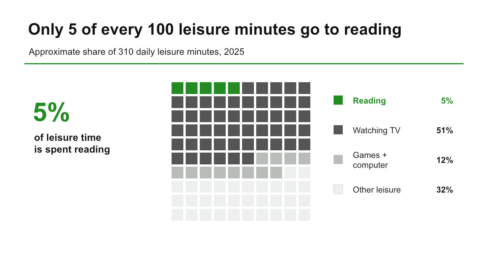
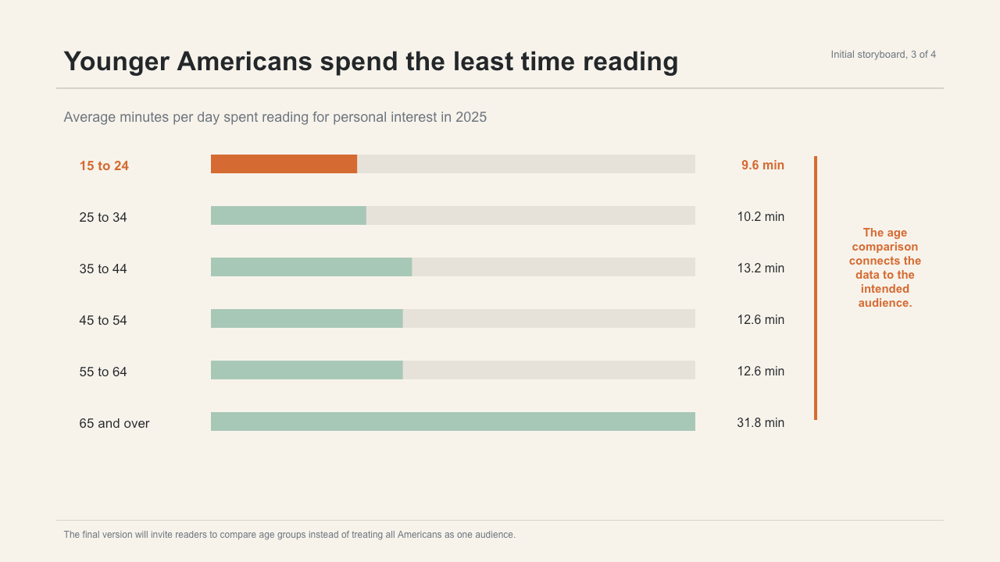
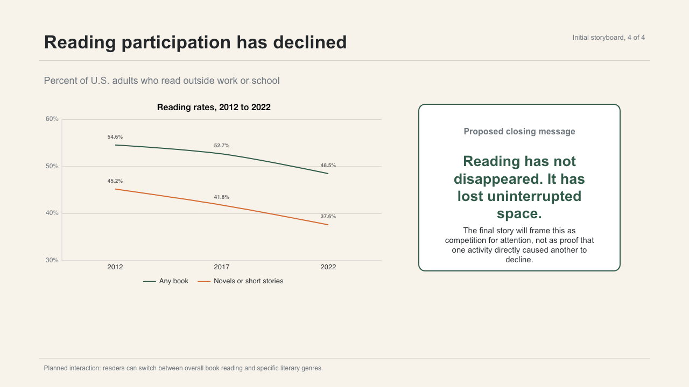

| [Home](https://yiranli-lyr.github.io/yiran-li-tswd-portfolio/) | [Data Visualization Examples](dataviz-examples) | [Critique by Design](critique-by-design) | [Final Project I](final-project-part-one) | [Final Project II](final-project-part-two) | [Final Project III](final-project-part-three) |

# Final Project Part I: Can Books Still Compete for Our Attention?

## Project summary

My initial idea was to examine why people no longer read or buy physical books. That question was too broad and mixed reading behavior with purchasing decisions. I am interested in this subject because I often expect a short break to become quiet reading time, but it can quickly turn into fragments of online content. I narrowed the project to a more specific question: how much space does reading occupy in Americans’ leisure time, and how does it compare with screen media such as television, games, and recreational computer use?

The project will focus on college students and young adults. A break that could provide time for sustained reading can easily become a series of notifications, short videos, and headlines. The available data cannot prove that digital media directly caused the decline in reading, so the story will present these activities as competitors for limited leisure time. The main idea is that reading has not disappeared, but it has less uninterrupted space in everyday life.

**One sentence summary:** Reading remains part of American life, but it occupies a small share of leisure time and competes with more immediate forms of screen media.

**User story:** As a college student who often checks a phone during short breaks, I want to see how Americans divide leisure time and how much remains for reading.

## Story structure

| Story section | Purpose | Planned evidence and presentation |
|---|---|---|
| Opening tension | Introduce the personal experience of losing patience while trying to read. | A digital book page marked at the point where sustained attention begins to break. |
| The competition for leisure time | Show how much leisure time reading receives. | Compare minutes spent reading with television, socializing, games, and recreational computer use. |
| The younger audience | Connect the national data to college students and young adults. | Compare daily reading time across age groups and highlight ages 15 to 24. |
| Change over time | Connect daily reading time with long term participation. | Show changes in the share of adults reading any book and reading novels or short stories from 2012 to 2022. |
| Closing reflection | Return to uninterrupted rest and attention. | Show reading's shrinking place within daily leisure. |

## Initial sketches

The sketches establish the story order: personal opening, leisure comparison, age comparison, and participation trend. I will rebuild the preliminary charts as interactive Tableau visualizations.

### 1. Opening question

### 2. Reading within daily leisure

### 3. Reading time by age

### 4. Reading participation over time

## The data

The U.S. Bureau of Labor Statistics American Time Use Survey provides 2025 annual averages for reading, television, games, recreational computer use, socializing, relaxing, and exercise. I converted the reported hours to minutes. These values will support the leisure and age comparisons in Tableau.

The National Endowment for the Arts 2022 Survey of Public Participation in the Arts provides comparable reading rates for 2012, 2017, and 2022. It measures reading outside work or school. Its population and definitions differ from the time use survey, so each source will appear in a separate visualization.

The American Time Use Survey records each respondent's primary activity. It can miss simultaneous phone use and does not isolate information feed scrolling. The project compares leisure activities without claiming that one caused another to decline.

| Data source | Public source | Planned use |
|---|---|---|
| American Time Use Survey, 2025 annual averages | [U.S. Bureau of Labor Statistics](https://www.bls.gov/opub/ted/2026/americans-age-15-and-over-read-for-an-average-of-16-minutes-per-day-in-2025.htm) | Compare daily leisure activities and reading time by age. |
| Survey of Public Participation in the Arts, 2022 | [National Endowment for the Arts](https://www.arts.gov/sites/default/files/2022-SPPA-final.pdf) | Show changes in book and literary reading from 2012 to 2022. |
| Prepared working data | [Download the Tableau-ready data file](final-project-assets/reading-attention-data.xlsx) | Contains the time use table, reading trend table, definitions, and source links. |

## Method and medium

I will build the visualizations in Tableau and publish them through Tableau Public. A Shorthand story will control the reading order. The Tableau views will support focused comparisons across age groups and reading measures. I used PowerPoint only for the Part I storyboard.

## References

Bureau of Labor Statistics, U.S. Department of Labor. (2026, July 22). [Americans age 15 and over read for an average of 16 minutes per day in 2025](https://www.bls.gov/opub/ted/2026/americans-age-15-and-over-read-for-an-average-of-16-minutes-per-day-in-2025.htm).

National Endowment for the Arts. (2023, October). [Arts participation patterns in 2022: Highlights from the Survey of Public Participation in the Arts](https://www.arts.gov/sites/default/files/2022-SPPA-final.pdf).

## AI acknowledgements

I used Gemini to help narrow the original topic, organize the initial story structure, and revise the wording. I checked the numerical values and source descriptions against the cited publications.
