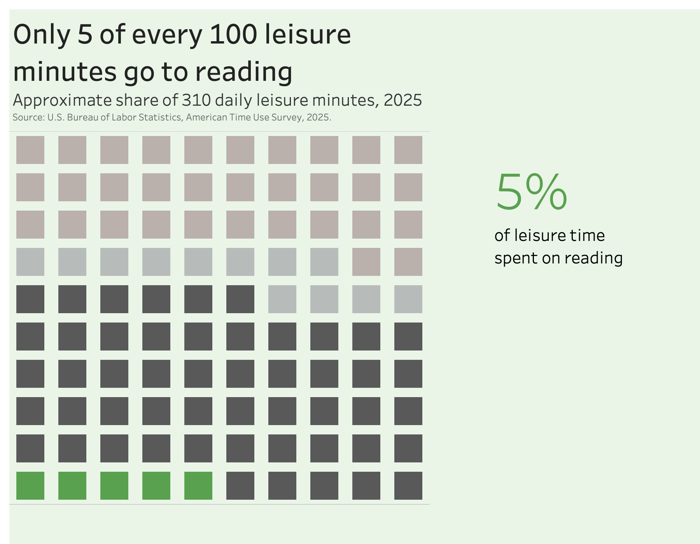
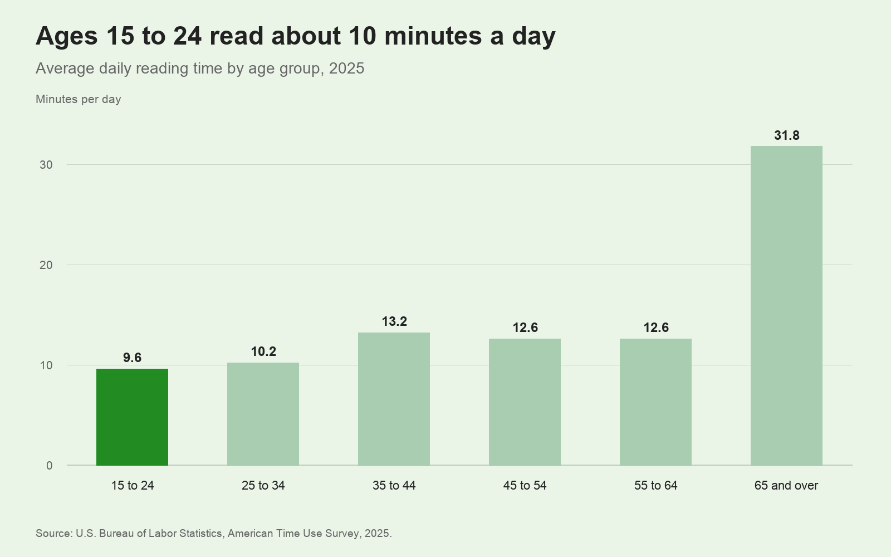
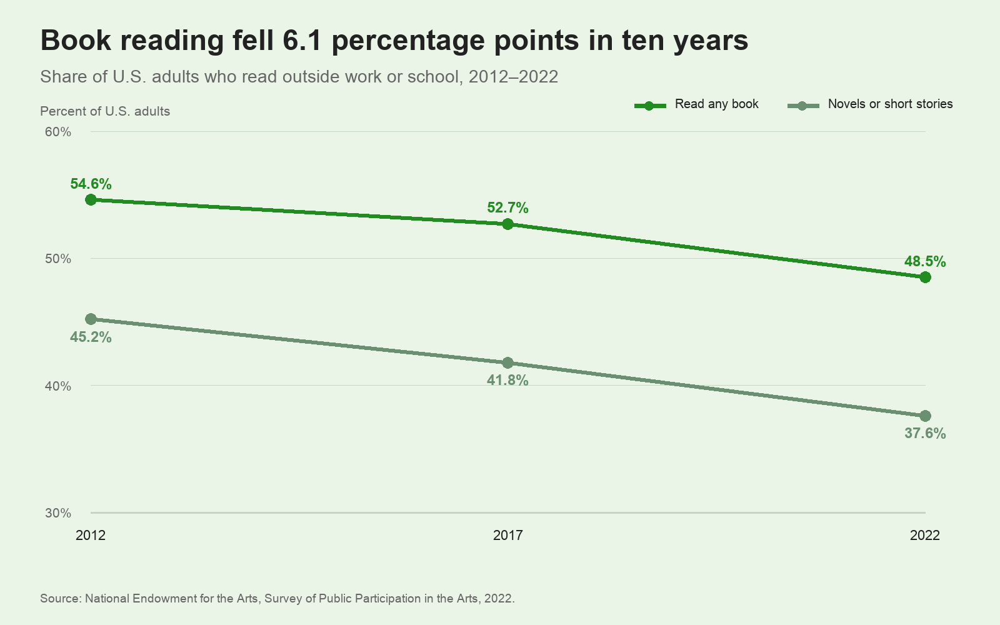

| [Home](https://yiranli-lyr.github.io/yiran-li-tswd-portfolio/) | [Data Visualization Examples](dataviz-examples) | [Critique by Design](critique-by-design) | [Final Project I](final-project-part-one) | [Final Project II](final-project-part-two) | [Final Project III](final-project-part-three) |

# Final Project Part II: Story Draft and User Research

# Wireframes and storyboards

## Tableau dashboard and charts

## Shorthand story draft

[View the complete Shorthand story draft](https://preview.shorthand.com/Y6KOWOaLpHBK2w55)

The draft follows the planned reading order: an electronic book opening, a waffle chart of daily leisure time, an age comparison, a 2012 to 2022 reading trend, and a short closing reflection. It establishes the full narrative path while leaving room to refine color, annotation, and transitions in Part III.

# User research

## Target audience and recruitment

The primary audience is young adults who rarely choose reading as a leisure activity and frequently use short breaks for phone based media. The story assumes interest in reading without requiring prior knowledge of time use research.

I recruited three master's students by asking for participants during class. They fit the young adult audience and could respond as ordinary readers rather than data visualization specialists. No names or identifying details are included.

## Research goals and interview script

I displayed the Shorthand draft in class and walked through it from the opening to the conclusion. After the presentation, I asked each participant the same three questions. The interviews tested whether the main idea was clear, whether each visual could be read quickly, and which design choices should change before Part III.

| Research goal | Questions |
|---|---|
| Test the narrative | What do you think this story is about? What is the main point after viewing it once? |
| Test visual clarity | Which visual is easiest to understand? Which one requires more effort? |
| Identify revisions | What color, label, or layout change would make the story clearer? |

## Interview findings

The notes below are concise paraphrases of the classroom feedback rather than verbatim quotes.

| Participant | Description | Observation | Design response |
|---|---|---|---|
| Interview 1 | Master's student | The waffle chart made reading's small share of leisure time easy to see. | Retain the waffle structure and keep its explanation brief. |
| Interview 2 | Master's student | Figure 3 needs a stronger visual indication that the comparison describes the United States. | Add U.S. to the title and emphasize the scope with the green accent color. |
| Interview 3 | Master's student | The logical progression from Figures 2 to 3 to 4 needs to be clearer. | Add short transitions that explain how each visual leads to the next. |

The feedback supports retaining the waffle chart. It also identifies two revisions: clarify the U.S. scope in Figure 3 and strengthen the transitions between Figures 2, 3, and 4.

# Identified changes for Part III

| Research synthesis | Planned change |
|---|---|
| Figure 3 does not make its U.S. scope immediately clear. | Add U.S. to the chart title and emphasize the scope with the green accent color. |
| The waffle chart is easy to understand. | Retain its structure and use it early in the story. |
| The progression from Figures 2 to 4 is not clear enough. | Add one short transition before Figures 3 and 4 to connect leisure time, age, and the long term reading trend. |
| The story uses multiple chart types. | Apply the same type hierarchy, green accent, and source treatment throughout. |
| The evidence comes from two surveys with different measures. | Keep the datasets in separate visuals and state the scope beside each chart. |

## References

Bureau of Labor Statistics, U.S. Department of Labor. (2026, July 22). [Americans age 15 and over read for an average of 16 minutes per day in 2025](https://www.bls.gov/opub/ted/2026/americans-age-15-and-over-read-for-an-average-of-16-minutes-per-day-in-2025.htm).

National Endowment for the Arts. (2023, October). [Arts participation patterns in 2022: Highlights from the Survey of Public Participation in the Arts](https://www.arts.gov/sites/default/files/2022-SPPA-final.pdf).

## AI acknowledgements

Generative AI was used to organize the interview protocol and edit the wording. The reported interview feedback came from the interviews and the final interpretations and design choices are my own.
