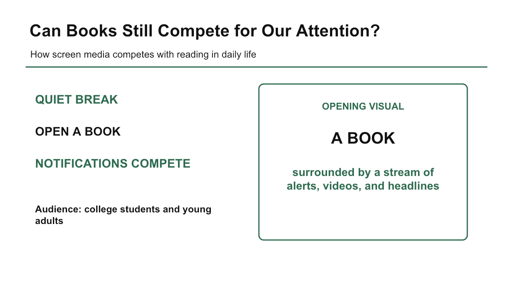
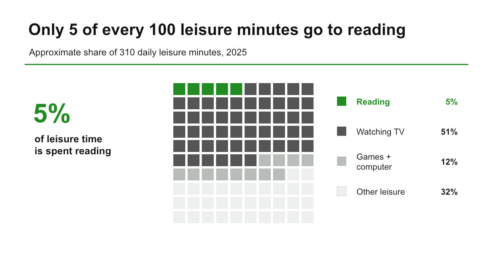
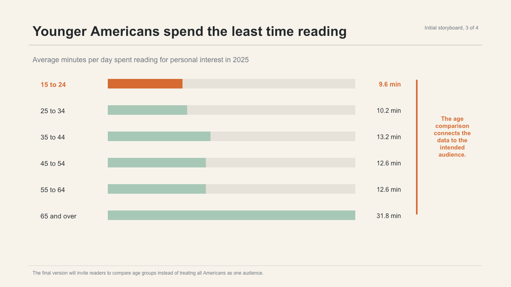
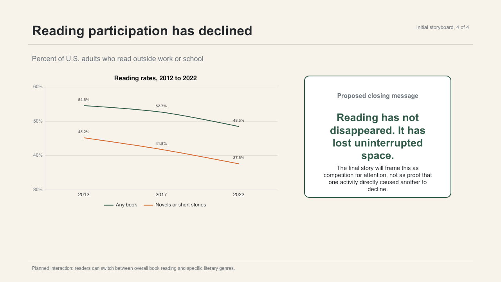

| [Home](https://yiranli-lyr.github.io/yiran-li-tswd-portfolio/) | [Data Visualization Examples](dataviz-examples) | [Critique by Design](critique-by-design) | [Final Project I](final-project-part-one) | [Final Project II](final-project-part-two) | [Final Project III](final-project-part-three) |

# Final Project Part II: Story Draft and User Research

## Shorthand story draft

[View the complete Shorthand story draft](https://preview.shorthand.com/Y6KOWOaLpHBK2w55)

The draft follows the planned reading order: an electronic book opening, a waffle chart of daily leisure time, an age comparison, a 2012 to 2022 reading trend, and a short closing reflection. It establishes the full narrative path while leaving room to refine color, annotation, and transitions in Part III.

## Wireframes and storyboards

The four visuals below define the main stages of the story. The Shorthand draft places them in the same order so readers move from a personal experience to national evidence.

### Opening

### Reading within daily leisure

### Reading time by age

### Reading participation over time

# User research

## Target audience and recruitment

The primary audience is college students and young adults who frequently use short breaks for phone based media. The story assumes interest in reading without requiring prior knowledge of time use research.

I showed the storyboard and Shorthand sequence to people within or close to this audience. I looked for participants who could comment on the story as ordinary readers rather than data visualization specialists. No names or identifying details are included.

## Research goals and interview script

The interviews tested whether the main idea was clear, whether each visual could be read quickly, and which design choices should change before Part III.

| Research goal | Questions |
|---|---|
| Test the narrative | What do you think this story is about? What is the main point after viewing it once? |
| Test visual clarity | Which visual is easiest to understand? Which one requires more effort? |
| Test emphasis | What attracts your attention first? Does any color or label need stronger emphasis? |
| Test engagement | Would you continue scrolling? Where does your attention begin to drop? |
| Identify revisions | What is the first change you would make? |

## Interview findings

The interviews produced two clear design findings.

| Feedback | Interpretation |
|---|---|
| Figure 3 should make the United States context more visually prominent. | The chart needs a clearer indication that its age comparison describes U.S. readers. |
| The waffle chart communicates the leisure time comparison well. | The part to whole structure is immediate and should remain in the final story. |

The positive response to the waffle chart was consistent with the goal of minimizing explanation. The color feedback identifies a specific revision for Figure 3 rather than a need to replace the visualization.

## Audience personas

| Audience profile | Reading behavior | Design need |
|---|---|---|
| College student | Reads on a phone between classes and often scrolls quickly. | Lead with the takeaway and keep text blocks short. |
| Casual reader | Is interested in books but rarely studies charts closely. | Use familiar chart forms, direct labels, and one focal color. |
| Data focused reader | Wants to know how the measures were defined and sourced. | Keep units, dates, sources, and limitations close to each visual. |

# Identified changes for Part III

| Research synthesis | Planned change |
|---|---|
| Figure 3 does not make its U.S. scope immediately clear. | Add U.S. to the chart title and emphasize the scope with the green accent color. |
| The waffle chart is easy to understand. | Retain its structure and use it early in the story. |
| Mobile readers need rapid orientation. | Add one short takeaway before each visual and remove unnecessary explanatory sentences. |
| The story uses multiple chart types. | Apply the same type hierarchy, green accent, and source treatment throughout. |
| The evidence comes from two surveys with different measures. | Keep the datasets in separate visuals and state the scope beside each chart. |

## References

Bureau of Labor Statistics, U.S. Department of Labor. (2026, July 22). [Americans age 15 and over read for an average of 16 minutes per day in 2025](https://www.bls.gov/opub/ted/2026/americans-age-15-and-over-read-for-an-average-of-16-minutes-per-day-in-2025.htm).

National Endowment for the Arts. (2023, October). [Arts participation patterns in 2022: Highlights from the Survey of Public Participation in the Arts](https://www.arts.gov/sites/default/files/2022-SPPA-final.pdf).

## AI acknowledgements

Generative AI was used to organize the interview protocol, develop the audience personas, and edit the wording. The reported interview feedback came from the interviews and the final interpretations and design choices are my own.
